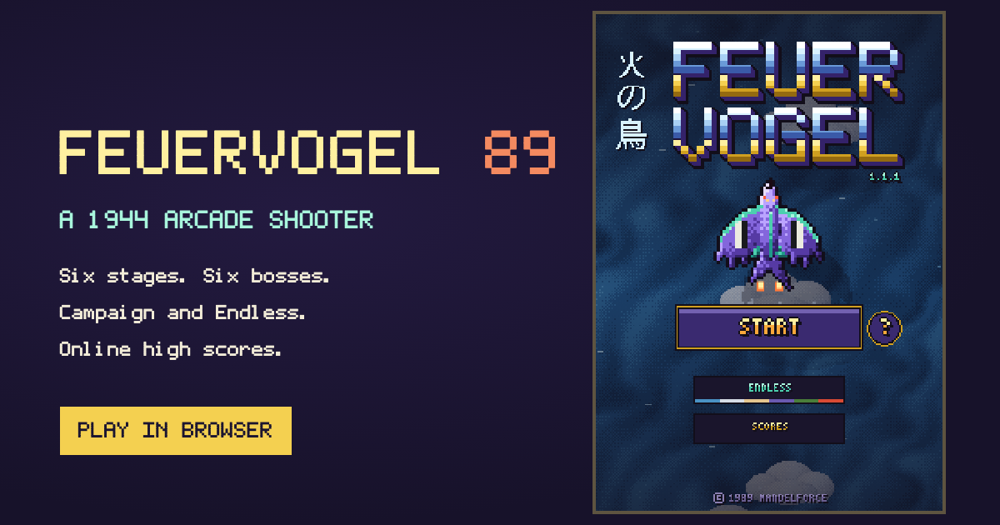

# FEUERVOGEL

**Steal the firebird. Turn it on the empire. Save the world, and yourself.**

FEUERVOGEL is a pixel-art vertical shoot 'em up and a love letter to the arcade shmups of the 90s: six levels, four weapons with four upgrade stages each, and a lot of action. It runs in any modern browser, on phone or desktop. No download, no account.

**[▶ Play FEUERVOGEL](https://mandelforce.github.io/feuervogel/)**

## The story

The Feuervogel is the evil empire's most dangerous machine, a stranded alien starship nobody was meant to fly. You take it, and now it's yours. Fight your way through six levels and six bosses, turn the empire's own weapon against it, and get out alive.

## The game

- **Campaign:** levels 1 to 6, six bosses: Cross the Channel, Sea of Sand, The Long Night, The Iron Forest, The Winter Line and The Burning City.
- **Four weapons, four upgrades each:** Scatter, Lance, Seekers and, from level 3, Arc. Level them up as you fly and each one changes how it looks and plays.
- **Nova bomb and super laser:** clear the screen with a Nova, or hold still to charge the laser and burn through armour.
- **Practice:** under Start, next to the tutorial, pick any Campaign level (1 to 6) and fly it on its own. Practice runs don't count for the Campaign board.
- **Three difficulties:** Rookie, Veteran or Ace, locked for the whole run.
- **Two players:** fly together on one screen, each with their own score and super laser.
- **Secrets:** every level hides one. Find all six to unlock the Schneevogel skin.
- **Tutorial:** new to shmups? Take the three-minute tutorial (the **?** next to Start).
- **Everything is drawn in code:** sprites, music and fonts are generated by the game itself.

## Online leaderboard

- A top-10 board per difficulty, split into mobile and PC.
- **All-time and weekly boards.** The weekly best-of resets every week, so there's always a fresh shot at the top.
- Two continues per run; continuing keeps your score. Runs finished without continues get a ★.
- **Offline?** Your score is saved on the device and submitted later, as soon as you're back online.

## Controls

| | Desktop | Phone |
|---|---|---|
| Fly | Mouse, arrow keys or WASD | Drag anywhere |
| Fire | Automatic | Automatic |
| Nova bomb | X or Space | Nova button |
| Pause | P or Esc | Pause button |

Game controllers work too, with rumble.

## Install on a phone

- **iPhone:** open the game in Safari, tap **Share**, then **Add to Home Screen**.
- **Android:** open it in Chrome, tap the menu, then **Install app**.

It then opens full screen from its own icon and works offline after the first visit.

## For developers

The whole game is one file, `index.html`, with no build step and no dependencies. GitHub Pages serves it straight from `main`.

| File | Purpose |
|---|---|
| `index.html` | The game |
| `sw.js` | Service worker for offline play |
| `manifest.json`, `icons/` | Home-screen app setup |
| `worker.js`, `schema.sql` | Leaderboard backend (Cloudflare Worker + D1). See [SETUP.md](SETUP.md) |
| `CHANGELOG.md` | What changed in each release |

**Run locally:** serve the folder with any static server, e.g. `python3 -m http.server`, and open `http://localhost:8000`. Local builds never submit scores to the live leaderboard.

**Releasing:** bump `VERSION` at the top of the script in `index.html` and `VERSION` in `sw.js`, and add the changes to `CHANGELOG.md`.

## Licence

All rights reserved. See [LICENSE](LICENSE).
