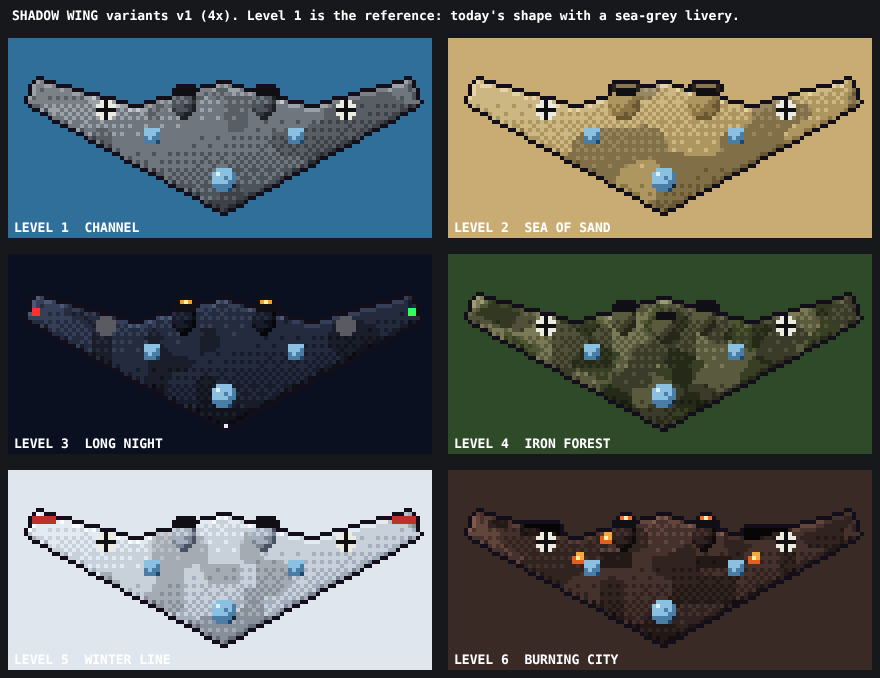
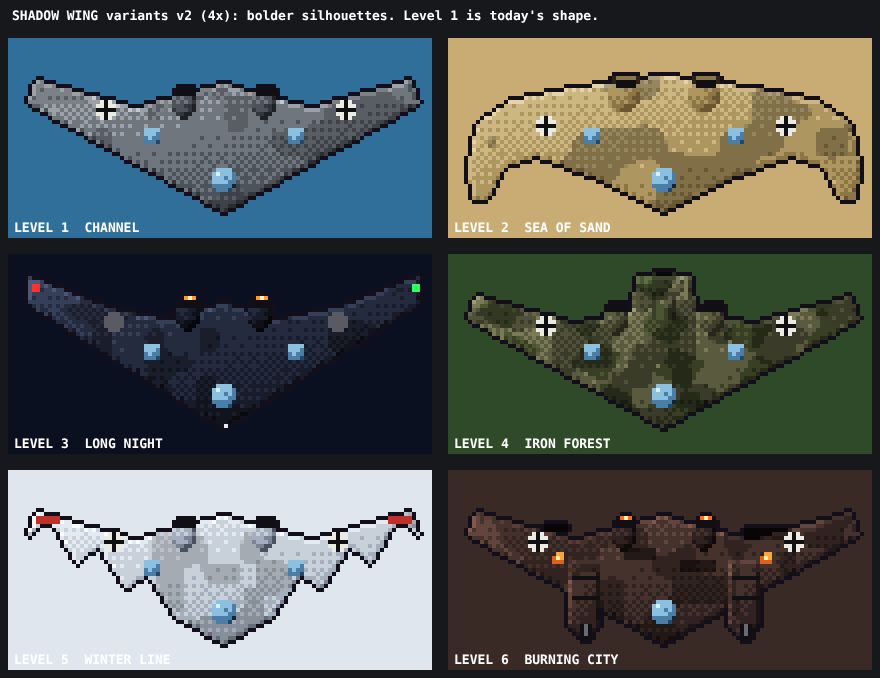
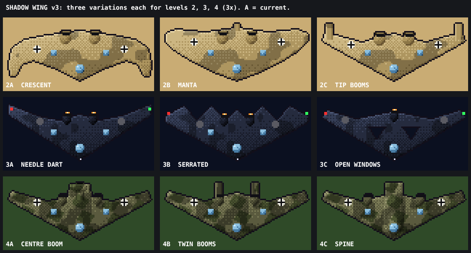
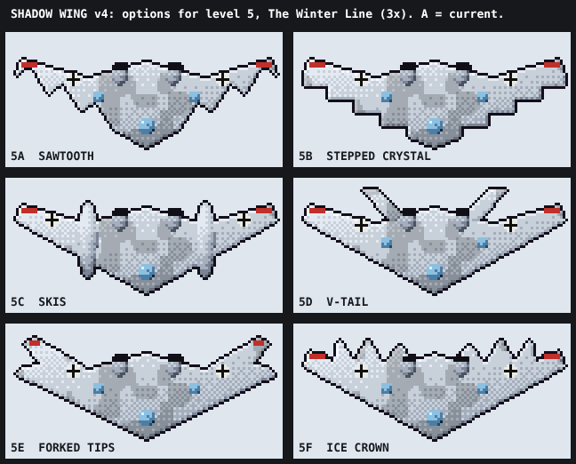
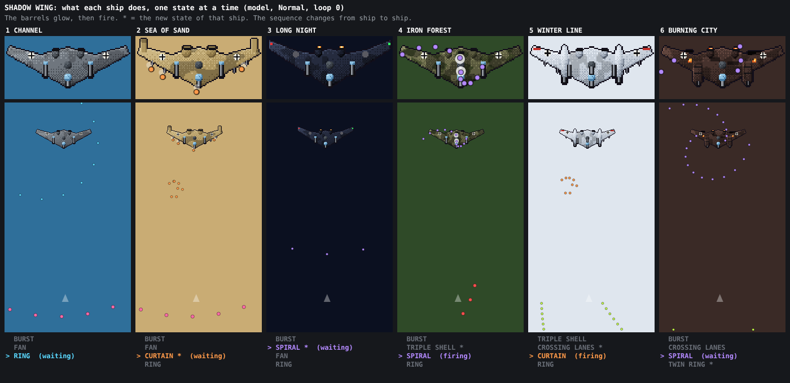

# Shadow Wing: six variants (design, step 1)

Status: proposal for approval. Nothing is wired into the game. Mock-up: `docs/shadow-wing-looks.png`, made by `docs/shadow-wing-art-v1.js` (`makeWingsV1()`, built with the game's own sprite helpers, same 100 x 40 size and shading as `SPR.wing`).



## 0. What I measured and found

- **Today's fight, measured in the game** (Enigma Run level 1, Normal, loop 0, the wing alone on screen, bot flying, 1600 frames): **peak 41 enemy bullets, average 18.5**, the peak at about frame 810, when the 16-shot ring overlaps a fan. Hard is the same (Normal and Hard share the bullet speed 1.34); Easy fires about a third fewer and a 0.65 ring. The measurement script is a throw-away; step 2 adds a proper check. The immortal bot clears bullets on a hit, so the real peak is a little higher.
- **Budget: 41 x 1.4 = about 57 bullets at loop 0.** The game's own cap is 420, so this is about readability, not the engine.
- **The level order is not the order I listed in the prompt.** The Enigma Run flies `STAGE_ORDER = [0, 2, 3, 4, 1, 5]`: Channel, Sea of Sand, Long Night, Iron Forest, Winter Line, Burning City. Levels 7 ("6B", the harbour city) and 8 ("1A", level 1 with islands) reuse the themes of levels 6 and 1 (`ENIGMA_BASE`). I fixed the prompt.
- **The Sower is not a single mini-boss.** It is a recurring forest enemy (`sowerTick`: first at 360 frames into a forest stretch, then every 1800 frames, HP 140, mines and bombs). The wing still appears in level 4 on its own timer.
- Today's patterns, for reference: **A** aimed 2-round burst every 48 frames, sides alternating; **B** 7-way fan of `'B'` shots every 180 frames; **C** ring of `16 + 2 * loop` every 300 frames. All three stay as the base of every variant.

## 1. The six variants

| Lvl | Tag in the boss bar | Livery (see mock-up) | One silhouette change | New or changed pattern |
|---|---|---|---|---|
| 1 Channel | SHADOW WING | Sea grey, today's camo | none | **none.** The reference: A, B, C as today, plus the tells below. Also used for level 8 (1A) |
| 2 Sea of Sand | SHADOW WING: DUST | Sand and khaki, tan splotches | Wider pods with dust filters over the intakes | **Curtain**: a row of 10 slow shots across the whole width with a 2-slot gap; the gap moves one to three slots from the last curtain |
| 3 Long Night | SHADOW WING: NIGHT | Near black, dim markings, red and green wingtip lights, amber exhaust glow | none (the lights are the change) | **Spiral**: two arms, 16 shots over 64 frames, slowly turning. The ring C drops from 16 to 12 in this variant |
| 4 Iron Forest | SHADOW WING: IRON | Splinter green over olive | A third pod on the centre line | **Triple shell**: the centre pod charges, then 3 big `'B'` shells, aimed, 14 frames apart. No mines or bombs (the Sower owns those) |
| 5 Winter Line | SHADOW WING: FROST | White wash over grey, red recognition bands on the tips | none (the bands are the change) | **Crossing lanes**: from each tip a line of 5 shots angled inward, so the two lines cross in an X in front of it |
| 6 Burning City | SHADOW WING: EMBER | Soot black, scorch marks, fires in the left wing, orange exhausts | none (the fires are the change) | **Twin ring**: C fires as two 12-shot rings, 24 frames apart, the second turned half a step (a checkerboard). Also used for level 7 (6B) |

Why each fits: the Channel wing is the lesson, so it stays a plain, honest version of today's fight. Dust, night and frost change what the player sees; iron and ember change what the player has to read. Night is the one level where bullets are easy to see on a dark ground, so it gets the prettier, slower spiral. The forest gets the fewest bullets because the Sower may be on screen. Level 6 is the finale of the run, so it gets the only pattern that doubles an existing one.

Per-variant movement stays today's sway (`x = W/2 + sin(mt * 0.011) * 50`). Dust may sway wider (amplitude 70) so its curtain gaps shift; that is the only movement change proposed.

## 2. Pattern budget

Each variant has the base A, B, C plus **at most one** new or changed pattern, so at most four. Estimates (loop 0, Normal) of the bullets a pattern adds at its worst overlap with the base, from speed times screen length divided by the period; step 2 replaces them with measurements:

| Pattern | Shots per use | Period (frames) | Speed (x bspeed) | Alive at once | Net change on the base peak |
|---|---|---|---|---|---|
| Curtain | 8 (10 less the gap) | 420 | 0.7 | about 8 | +8 |
| Spiral (ring C 16 to 12) | 16 | 480 | 0.6 | about 16 | +12 |
| Triple shell | 3 | 360 | 1.15 | about 3 | +3 |
| Crossing lanes | 10 | 360 | 1.0 | about 10 | +10 |
| Twin ring (replaces C) | 24 (2 x 12) | 300 | 0.75 | about 24 | +8 |

All stay under 41 + 12 = about 53, inside the 57 budget. Easy and Hard scale through the existing `DIFF.ring` and `DIFF.skip`, so the patterns go through `eshot` and `ring` and inherit them.

**Tells** (every new pattern, and the base ones too, cheaply): 30 to 45 frames before it fires, something on the wing shows it. A flash of the exhausts for the ring and spiral, the centre pod glowing for the triple shell, the tips flashing for the curtain and lanes. The audio cue is the existing `sfx('cannon')` moved to the start of the tell.
**Gaps:** every pattern leaves a lane the ship can reach at normal speed (the curtain's 2-slot gap is about 45 px wide; step 2 checks that against the ship's speed and hit size). Spiral arms are far enough apart that they cannot close a lane.

## 3. Escalation

Level 1 plays like today. The bullet count, the new pattern's size and the sway change in small steps up to level 6 (above: +0, +8, +12, +3, +10, +8, where the forest is low on purpose). HP stays `260 * (1 + 0.35 * loop)` in every variant, and the ring size, the speed and the fire rates keep their `loop` and `DIFF` scaling, so the Enigma Run's rank (`rankFor`) is the only thing that makes a later level harder. [verify in step 2 how `run.loop` is set in the Enigma Run, so the later variants do not stack on top of a rank that is already high.]

## 4. Candidate patterns

Considered and **picked**: curtain, spiral, triple shell, crossing lanes, twin ring.
Considered and **dropped**: a charge down the screen and back (it changes the wing's role and the bot's tests), drones from the pods (a second enemy type to balance, and the Sower already uses the air for support units), mines (the Sower's), a delayed-burst shell (needs a bullet that changes while it flies; `eshot` has no such kind). Any of them is a later recipe, not a new system.

## 5. The recipe format

The wing becomes data. A variant is one object; the look is built from it and the fight is run from it.

```js
WING_RECIPES.sd = {
  tag: 'SHADOW WING: DUST',
  look: { ramp: 'sand', camo: [0.56, 0.74, 0.13, 23], pods: [[40, 12], [60, 12]], podRx: 4.2, filters: true, exhaust: null, marks: 'cross' },
  move: { amp: 70, rate: 0.011 },
  weapons: [                                  // `at` is the frame within the cycle; `tell` frames come before it
    { p: 'aimedBurst', every: 48,  at: 0,   tell: 0,  side: 'alt', n: 2 },
    { p: 'fan',        every: 180, at: 90,  tell: 20, n: 7, spread: 0.16, speed: 0.9 },
    { p: 'ring',       every: 300, at: 210, tell: 30, n: 16, speed: 0.75 },
    { p: 'curtain',    every: 420, at: 330, tell: 40, slots: 10, gap: 2, shift: [1, 3], speed: 0.7 }
  ]
};
```

- **Look** (`docs/shadow-wing-art-v1.js` already builds all six this way): a palette ramp from `RP`, camo numbers, pod positions and size, and flags for the details (filters, lights, bands, scorch, fires, exhaust colour). One builder, no per-level drawing code. Sprites are baked once at load, like `SPR.sower`.
- **Weapons:** a small library of pure functions that only call `eshot` and `ring`: `aimedBurst`, `fan`, `ring`, `curtain`, `spiral`, `tripleShell`, `lanes`, `twinRing`. The wing's `update` runs the list: `if ((e.mt - w.at) % w.every === 0) LIB[w.p](e, w, ctx)`, and shows the tell from `w.tell` frames earlier. No per-level `if` in the update.
- **Pick:** the variant comes from the level's theme (`ENIGMA_BASE`, so 6B uses Ember and 1A uses Channel). For the Campaign wing nothing changes.

### Ready for the Generative mode

The same recipe can be drawn from parts and a seed (`sortieHash`-style, so it stays repeatable):

- **Look parameters:** ramp (any `RP` ramp or a dark or frost one), camo threshold and scale, 2 or 3 pods, pod size, one of the details (filters, lights, bands, scorch, fires), exhaust colour, markings.
- **Fight parameters:** the base three with a tuned size, plus **zero or one** pattern from the library with its own numbers (count, speed, gap, period).
- **Fairness rules a generator must satisfy** (checked by one function, `wingBudget(recipe, loop, diff)`, which step 2 also uses in its test):
  1. Peak bullets, estimated as the sum over weapons of `count * lifetime / period`, at most 1.4 times today's peak (57 at loop 0), scaled by the same `loop` and `DIFF` factors as today.
  2. At most one new or changed pattern.
  3. Every pattern has a tell of at least 30 frames.
  4. Every pattern leaves a lane at least 2.5 times the ship's hit width, reachable at ship speed.
  5. No two patterns fire in the same frame; offsets differ by at least 20 frames.
  6. Shot speed within 0.6 to 1.15 of `bspeed()`; HP never above today's formula.

## 6. Open choices

1. **Scope.** Recommendation: the Enigma Run only, with the old Campaign wing left as it is (it is the legacy mode and its replay baseline is gone anyway). Say if the Campaign should get the variants as well.
2. **Level 4.** Recommendation: keep the wing, and hold a new Sower while the wing is alive, so the two never share the screen. Alternative: let them overlap and rely on the forest variant's low count.
3. **Drops and pilot bail-out:** unchanged (`W`, `B`, `T`, 50 percent bail-out).
4. **Boss-bar names:** the tag column above (all start with SHADOW WING), or one name for every level.
5. **Silhouette:** only the Dust pods and the Iron third pod change the shape; the others are livery only. Say if you want more change, for example swept tips for Night.

## 7. Bolder shapes (answer to open choice 5)

Mock-up: `docs/shadow-wing-looks-v2.png`, from `docs/shadow-wing-art-v2.js` (`makeWingsV2()`). Each recipe now carries its own hull polygon. The nose, the cockpit and the 100 x 40 canvas stay, so the wing still reads as one aircraft and the hit box (hw 44, hh 12) stays valid.



| Lvl | Shape change | Gameplay reading |
|---|---|---|
| 1 Channel | none | the reference |
| 2 Sea of Sand | A crescent: the tips curve forward into two horns, a concave leading edge | Heavy and scythe-like, which fits a curtain that sweeps across the screen. The horns are where the tips flash for the tell |
| 3 Long Night | Needle tips raked far back, a deeper notch in the trailing edge, wingtip lights | A sharp, fast-looking dart: fits the spiral; the tip lights give the dark level its landmarks |
| 4 Iron Forest | A tail boom with a tailplane on the centre line, a third pod | The boom points up the screen, away from the player; the pod is the triple shell's gun |
| 5 Winter Line | A sawtooth leading edge, four teeth a side, red bands on the tips | Reads as ice and frost. Each tooth is a natural origin for one shot of the crossing lanes, so the lanes can come from the teeth |
| 6 Burning City | Two heavy gun nacelles hung forward of the leading edge, barrels pointing at the player, fires, soot | A gunship: the barrels are where the twin ring and the aimed burst visibly come from. Symmetric, so nothing needs a side rule |

Notes:
- A shape that is only drawn bigger than its hit box lies to the player. The crescent's horns and the Ember gun nacelles reach 4 to 10 pixels below the hit box (hw 44, hh 12), and the sawtooth teeth about 4. Step 2 either gives those three variants their own `hw` and `hh` (recipe fields) or keeps the hit box and says so in the report. My recommendation: Sand `hw` 48, Ember `hh` 16 (the nacelles are armour), Winter unchanged.
- The Ember wing's barrels point straight down, so its aimed burst can fire from them (the nacelle x positions replace the old `e.x +- 18` side offsets): one recipe field, `muzzles: [-40, 40]`.
- Night's sharp tips are about 2 pixels thin at the end; on a phone at the smallest size they may vanish. If so, the tip lights carry the silhouette.
- The first v2 ideas for 2, 5 and 6 (blunt tips with drop tanks, ski-like winglets, a broken left tip) were replaced after review.
- The shape is the cheapest generative knob: a hull is a short polygon, so a generator could sweep, blunt or drop the tips by a few numbers. The fairness rules stay as in section 5, plus: the hull stays inside the 100 x 40 canvas and its widest point within 4 pixels of the hit box.

## 8. Variations for levels 2, 3 and 4

Mock-up: `docs/shadow-wing-looks-v3.png`, from `docs/shadow-wing-art-v3.js` (`makeWingsV3()`, on the v2 builder, which gained `booms`, `holes` and `spine`). Option A in each row is the shape from section 7.



| Option | Shape | Reading |
|---|---|---|
| 2A Crescent | Tips curve forward into horns | Scythe; the curtain sweeps like a blade |
| 2B Manta | Rounded wide wing, a small stinger at the tail | Calmest and closest to today; a dune creature |
| 2C Tip booms | Today's hull with a short boom standing up at each tip | Smallest change, reads at once; the booms are where the curtain's tell flashes |
| 3A Needle dart | Tips raked far back | Fast and thin; the risk is the 2 px tips vanishing at small sizes |
| 3B Serrated | Three teeth on the trailing edge (a stealth-bomber look) | The strongest silhouette in the dark; the teeth could hold the spiral's two arms |
| 3C Open windows | Two triangular cut-outs in the wing, one centre pod | Ghostly: the night sky shows through; costs nothing in the hit box |
| 4A Centre boom | One tail boom and a third pod on the centre line | Reads as a rudder |
| 4B Twin booms | Two tail booms behind the pods, no centre pod | Lighter and more agile |
| 4C Spine | A fuselage spine down the centre with a bulbous front | The heaviest, a gun in the nose: the best match for the triple shell |

Notes: all nine are inside the 100 x 40 canvas and keep the nose and cockpit. The cut-out windows are only a visual: bullets and the player's shots ignore them (the hit box is a rectangle). 2C, 3B and 4B add only a few pixels beyond today's hit box, so the hit box could stay as it is for those.

## 9. Decisions so far and options for level 5

**Chosen:** level 1 today's shape (sea-grey livery); level 2 **2C tip booms**; level 3 **3A needle dart**; level 4 the **first forest wing** (today's hull, a third pod on the centre line, no tail boom; the `fr` recipe of `docs/shadow-wing-art-v1.js`). Levels 5 and 6 are open (level 6 stays the gun nacelles of section 7 unless you say otherwise).

Mock-up: `docs/shadow-wing-looks-v4.png`, from `docs/shadow-wing-art-v4.js` (`makeWingsV4()`; the builder gained `floats` and `fins`). The red tip bands and frost livery are the same in all six.



| Option | Shape | Reading |
|---|---|---|
| 5A Sawtooth | Four big teeth along the leading edge | Ice; each tooth can be the origin of one crossing-lane shot |
| 5B Stepped crystal | A staircase leading edge, like a stepped pyramid or ice crystal | Blocky and strong in a small size; the steps give a clear left/right rhythm |
| 5C Skis | Two long floats along the wing, outside the pods | The most winter-specific idea (a plane on skis); reads as heavy and slow |
| 5D V-tail | Two fins angled up and out behind the trailing edge | Sleek and fast; the fins could be where the crossing lanes start |
| 5E Forked tips | Each tip splits in two prongs | Tiny change, reads like antlers or a tuning fork |
| 5F Ice crown | Three spikes along the trailing edge on each side | A crown of icicles at the back, away from the player; the bullets still come from the front |

My pick: **5C skis** for the story, **5B stepped crystal** if you want the cleanest read at the smallest size. 5C's floats stick out below the leading edge by about 6 pixels, so give it `hh` 16 as with the nacelles.

## 10. Pattern sequences, ship by ship (revised after review)

Review feedback on the first model: the patterns ran at the same time and overlapped, the ships did not seem to evolve, and the ships had no visible guns, so bullets seemed to appear from nowhere. Changed:

1. **One state at a time.** Each ship runs a **sequence** of states (burst, fan, ring, ...). A state has an *aiming* part (its barrels glow for 24 to 40 frames), a *firing* part, and a *clearing* part. The next state starts when the wing's own shots have passed the middle of the screen (at most 450 frames; this was first "all gone", see section 11). This replaces the concurrent timers of sections 0 and 2 in the model; the old timers stay in the game until step 2 decides.
2. **The sequence evolves from ship to ship.** A ship keeps part of the previous one and adds its new state (marked with a star).
3. **Every shot leaves a visible barrel.** Each sprite has the guns for its states, and a muzzle flash shows at the start of every shot (`docs/shadow-wing-art-v5.js`, `WING_MUZZLES` lists where each shot starts).

Video (plays in the app): `docs/shadow-wing-patterns.mp4`, 22 seconds at 1.5 times speed, all six ships side by side, each with a zoomed inset of the wing and a list of its states with the current one marked. Still: `docs/shadow-wing-patterns.png`. The page `docs/shadow-wing-patterns.html` is the same model (needs a browser that runs scripts).



| Ship | Sequence (new state starred) | Guns it uses |
|---|---|---|
| 1 Channel | burst, fan, ring | side turrets, nose cannon, centre turret |
| 2 Sea of Sand | burst, fan, **curtain**, ring | + four hairline barrels under the leading edge (two a side, one pixel wide); with the nose cannon they make five curtain guns |
| 3 Long Night | burst, **spiral**, fan, ring (12 shots) | the centre turret turns for the spiral |
| 4 Iron Forest | burst, **triple shell**, spiral, ring | + a heavy barrel on the centre line; the fan is dropped, the spiral is kept from ship 3 |
| 5 Winter Line | triple shell, **crossing lanes**, curtain, ring | + a gun on the front of each ski and the four small underwing barrels; the burst is dropped, the curtain comes back from ship 2 |
| 6 Burning City | burst, crossing lanes, spiral, **twin ring** | the nacelle guns fire the burst and the lanes; the centre turret fires the spiral and both rings |

States in detail (Normal, loop 0, speeds are times the base bullet speed 1.34):

| State | What it does | Aiming (glowing barrels) |
|---|---|---|
| Burst | 3 volleys 48 frames apart, alternating turrets, 2 aimed shots each | side turrets (nacelles on ship 6), 24 frames |
| Fan | 2 fans of 7 shots, 55 frames apart, aimed | nose cannon, 24 |
| Ring | 16 shots in all directions (12 on ship 3) | centre turret, 30 |
| Curtain | 2 rows of 8 slow shots (0.7) from five guns (the four underwing barrels and the nose cannon), two shots each, spreading; one gun is skipped, so there is a gap that moves | the five guns, 40 |
| Spiral | 12 steps of 2 shots, two arms turning, slow (0.6) | centre turret, 40 |
| Triple shell | 2 salvos of 3 big aimed shells (1.15), 14 frames apart | heavy barrel, 40 |
| Crossing lanes | 6 pairs from two guns, angled inward so they cross | ski or nacelle guns, 40 |
| Twin ring | 2 rings of 12, 24 frames apart, the second turned half a step | centre turret, 30 |

Because only one state is on screen at a time, the bullet peak is far below the old 57 budget (the largest single state is about 30 bullets). That frees the design: a later version of this model can let ship 5 and 6 run two states in a row without a gap, if you want them to feel harder. A ship's sequence takes about 1100 to 1700 frames (18 to 28 seconds); the wing stays 1600 frames, so it fires one cycle per fight on the early ships and nearly one on the late ones. [verify in step 2: the wing leaves after 1600 frames; do we want a longer stay or a shorter cycle?]

Decided: the curtain guns on ships 2 and 5 are hairline barrels (one pixel wide, about 3 px sticking out), plus the nose cannon in the middle.

Open: is the order and mix of the sequences right? They are one list per ship in the model (`SEQ`), so they are cheap to change.

## 11. Step 2: built (version 1.2.5.2)

The six ships are in the game (`index.html`: `WING_V`, `wingSprite`, `wingSeq`, `wingFire`). The recipes are the ones of this note, the sprites are drawn by the same builder as the mock-ups, and every shot starts at a muzzle with a flash. Decisions I took where the note left a choice open (all easy to change):

- Enigma Run only; Retro Run keeps the old wing. Levels 7 (6B) and 8 (1A) use the ships of 6 and 1.
- Level 4: a new Sower is held back while the wing is alive (`sowerTick`).
- Drops, pilot bail-out and HP (`260 * (1 + 0.35 * loop)`) are unchanged. The boss bar shows "SHADOW WING" plus the tag (DUST, NIGHT, IRON, FROST, EMBER).
- Hit boxes: Sand 48 x 12, Winter Line and Burning City 44 x 16, the others 44 x 12 as today.
- The old concurrent timers of the Enigma Run wing are gone; the loop rank still adds 2 shots to the ring and 1 to each twin ring, and speeds still follow `bspeed()`.

Measured in the game (`tests/wing.mjs`, Normal, loop 0; no golden baseline exists, so `tests/replay.mjs` was not used): the right ship in every level, states in the order of the sequence, no state starts while its own shots are on screen, not one shot started away from a muzzle. The wing's own bullets peak at 16 to 26 (the old fight: 41).

**What the game showed, and what was decided.** With the first version (the next state waits until the wing's own shots are all gone) the test bot killed the wing in about 750 to 1040 frames, but a full sequence took 1100 to 1700, so a fight showed only two or three states. Decided: **shorter waits.** The next state now starts when the wing's own shots have all passed the middle of the screen (or after 450 frames). Shots in the lower half can still be in flight, but nothing is left in the upper half where the wing and the new aim are. The 2 x 2 results of `tests/wing.mjs` (as it is, bot flying, Normal):

| Level | States seen before the wing dies | Peak own bullets |
|---|---|---|
| 1 and 1A | burst, fan, ring, burst, fan (the whole sequence and more) | 29 |
| 2 | burst, fan, curtain, ring (all) | 21 |
| 3 | burst, spiral (2 of 4) | 24 |
| 4 | burst, triple, spiral (3 of 4) | 24 |
| 5 | triple, lanes, curtain, ring (all) | 32 |
| 6 and 6B | burst, lanes, spiral, twin (all) | 32 |

Levels 3 and 4 still end early (the spiral state is long, and the bot kills the wing sooner there). If that matters, the cheapest next step is a faster spiral or a shorter tell on those two; I have not changed them.
